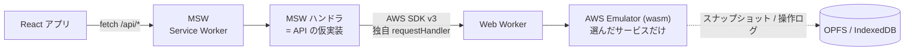

# 計画書：AWS Emulator をブラウザ内で動かす（aws-emulator-wasm）

## 1. 目的

[AWS Emulator](https://github.com/aws/aws-emulator)（AWS 公式、Rust 製、2026-11-11 GA）を wasm にビルドし、**ブラウザの中だけで完結するモック API の接続先**として使えるようにする。

- React アプリの開発用モックを MSW で書き、ハンドラの中身を「固定 JSON」ではなく「AWS SDK v3 → ブラウザ内の AWS Emulator」にする。
- 成果物は GitHub Pages などの**静的配信だけ**で動く。サーバー・Docker・AWS アカウントは不要。
- 想定する使い手：リモートのコーディングエージェント。サンドボックスで Docker を使えなくても、生成したアプリを URL ひとつで人に確認してもらえる。

## 2. 非目標

- AWS Emulator の全サービス（約 450）を載せること。必要なサービスだけを選ぶ。
- 本番用途。開発・デモ・確認用に限る。
- 上流への貢献。上流は PR を受け付けない（README の "This repository does not take PRs"）。

## 3. 構成

| 層 | 役割 |
|---|---|
| `@aws-emulator-wasm/client`（TS） | AWS SDK v3 用の `requestHandler`。`HttpRequest` を Worker に postMessage し、`HttpResponse` を返す。通信しない（ddblite の `engine-transport.ts` と同じ方式） |
| Worker（TS） | wasm を読み込み、リクエストを順に渡す。永続化と複数タブの調停も担う |
| wasm（Rust） | 自前の薄い router ＋ 上流のサービスクレート。`handle(request) -> response` を公開する |
| パッチ集 | 上流を wasm で動かすための最小限の改造。上流の更新に追従できるよう、スクリプトで当て直す |

## 4. 上流の調査結果（commit `813af480bf7f16d5418b64e4f5644a74a7da11c5`, 2026-11-14）

| 項目 | 事実 | 影響 |
|---|---|---|
| embedded mode | `AwsEmulatorEmbedded::http_client()` がネットワークなしで in-memory engine に応答する | ブラウザでも同じ「router にリクエストを渡す」形で使える |
| router | `core/router` が 461 クレートに無条件依存。`[features]` なし | 自前の router が必要 |
| サーバー層 | `vendor/server` が tokio `full`、hyper、axum-server（tls-rustls）、rustls（aws-lc-rs）、aws-lc-rs、rcgen に依存 | wasm で壊れる最有力。`cfg` で外すパッチが要る |
| サービス間依存 | DynamoDB → S3 / Kinesis / DynamoDB Streams、S3 → KMS。Lambda → SQS / IAM / Kinesis / DynamoDB / EC2 / ECR / Logs / STS | 1 サービスでも数サービスを引き込む |
| 時刻 | `tokio::time::sleep`（DescribeTable の待ち、ESM の poller） | シングルスレッドの実行器で時刻を進める必要 |
| 乱数 | getrandom 0.3、uuid v4 | wasm 用の backend 指定が要る |
| 認証 | SigV4 検証は CLI `-a on/off`、embedded の既定は Off | ブラウザでは Off |
| Lambda | Node は rquickjs（QuickJS, C）、Python は RustPython をプロセス内で実行。スレッドで実行し、時間切れは放置。nix / libc / memory-stats を使う | 後回し。Python から着手 |
| ビルド負荷 | 公式は target/ に 100GB 以上を推奨（全サービス） | サービスを絞れば小さくなる見込み（要計測） |

## 5. 設計判断

1. **ビルドターゲット**：まず `wasm32-wasip1` と、ブラウザ用の WASI シム（例：`@bjorn3/browser_wasi_shim`）を試す。std の fs / 時刻 / 乱数がそのまま動き、C の依存も wasi-sdk でビルドしやすい。だめなら `wasm32-unknown-unknown` + wasm-bindgen。
2. **スレッドなし**：GitHub Pages は COOP/COEP ヘッダーを付けられないので SharedArrayBuffer が使えない。ヘッダーを補う Service Worker の手もあるが、MSW の Service Worker と衝突する。tokio は `current_thread` 相当で動かす。
3. **自前の router**：使うサービスだけを登録する。登録していないサービスには上流と同じ「未実装」の応答を返す。
4. **パッチは最小・機械的に**：`patches/` に差分を置き、`scripts/sync-upstream.sh` で上流の指定 commit を取得して当てる。上流の commit は固定し、更新は明示的に行う。
5. **永続化**：エンジンに状態の書き出し機能がなければ、状態を変えるリクエストを記録しておき、起動時に再生する。
6. **テレメトリ**：wasm ビルドでは送信しない空実装にする（ブラウザから外部へ送らない）。
7. **ライセンス**：上流のライセンス表記（Apache-2.0 ほか、クレートごとの SPDX）を配信物に同梱する。

## 6. 段階計画

| Phase | 内容 | 完了条件 |
|---|---|---|
| 0 検証 | DynamoDB とその依存（S3 / KMS / Kinesis / Streams）を wasm 向けに `cargo check` し、壊れる箇所を一覧にする | `docs/phase0-report.md` に、壊れたクレートと理由、対処案がある |
| 1 最小動作 | DynamoDB・S3・SQS を Worker で動かし、MSW から使う Todo デモを GitHub Pages に公開 | ブラウザで CRUD が通る。Playwright のテストが緑 |
| 2 実用化 | スナップショット、複数タブ、wasm のサイズ削減、読み込みの遅延 | リロード後も状態が残る。初回読み込みの目標サイズ（Phase 1 で計測して決める） |
| 3 拡張 | Lambda（Python から）、Cognito など | 選んだサービスの代表的な操作が通る |

## 7. リスク

| リスク | 対策 |
|---|---|
| ビルド環境の不足（全体は 100GB 級） | サービスを絞る。Phase 1 以降は大きめの CI ランナーを検討 |
| aws-lc-rs など C の依存が wasm で通らない | 機能フラグで外す。外せなければ pure Rust の代替（`ring` は wasm 対応あり、要確認）に差し替え |
| wasm が大きすぎる | サービスの選択、`wasm-opt -Oz`、サービスごとの遅延読み込み |
| 上流の変化が速い（エージェントが生成・更新） | commit を固定。パッチを小さく保ち、当て直しをスクリプトにする |
| 上流と挙動が変わる（シングルスレッド化、時刻） | 上流のテストのうち wasm で動くものを流す。fidelity の差分を記録 |

## 8. 未決事項

- 最初に載せるサービスの最終決定（仮：DynamoDB・S3・SQS）。
- Phase 1 以降のビルド環境（GitHub Actions の大きいランナーなど）。
- リポジトリの公開範囲。Pages を無料で使うなら public が必要（今は private）。
