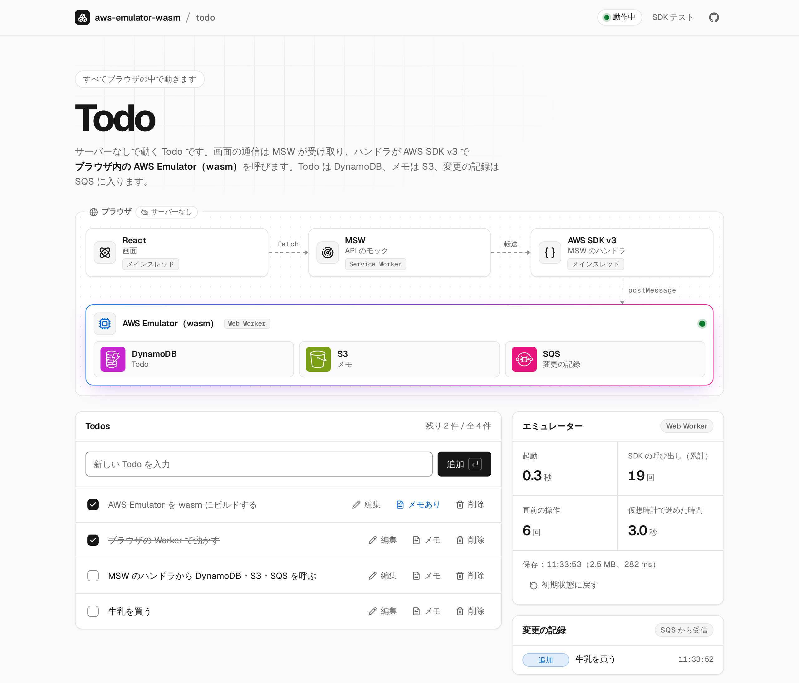
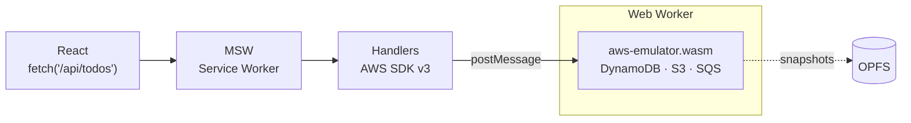

<div align="center">

# aws-emulator-wasm

**AWS in a browser tab.**

[AWS Emulator](https://github.com/aws/aws-emulator) compiled to WebAssembly and run in a Web Worker.<br>
Point AWS SDK v3 at it and get DynamoDB, S3 and SQS with no server, no Docker and no AWS account.

[](https://github.com/daisuke-awaji/aws-emulator-wasm/actions/workflows/wasm.yml)
[](https://daisuke-awaji.github.io/aws-emulator-wasm/)


[**Live demo**](https://daisuke-awaji.github.io/aws-emulator-wasm/) · [SDK round-trip tests](https://daisuke-awaji.github.io/aws-emulator-wasm/sdk.html) · [How it works](#how-it-works)

<picture>
  <source media="(prefers-color-scheme: dark)" srcset="./docs/img/readme-dark.png">
  
</picture>

</div>

## Why

A static site cannot talk to AWS, so a mock app usually needs a backend somewhere: a local stack in Docker, or a real account. That is a problem when the app was built by a remote coding agent and someone just wants to click through it.

This project moves the backend into the page. The demo is plain static files on GitHub Pages. Its API calls are caught by [MSW](https://mswjs.io/), and the handlers use the real AWS SDK v3 against an emulator inside the same tab. Share the URL, and the whole stack comes with it.

## Highlights

- **The real SDK, unchanged.** `DynamoDBClient`, `S3Client` and `SQSClient` work with one `clientConfig()`. Only the request handler is swapped: requests go to the Worker instead of the network.
- **Upstream code, not a rewrite.** The Rust emulator is built for `wasm32-wasip1` from a pinned upstream commit with a small patch set. A 280-line WASI shim runs it in browsers and Node.
- **Survives a reload.** With `persist`, the Worker saves a gzip snapshot of the wasm memory to OPFS when requests pause, and restores it before `ready`.
- **One tab owns the state.** A second tab waits and can take over (Web Locks), so two tabs never overwrite each other's data.
- **No waiting on timers.** A virtual clock skips ahead when the emulator sleeps, for example while a new DynamoDB table "becomes active".
- **Every call is visible.** `onCall` reports each request with its status and timing. The demo shows them per action: adding a todo is 6 SDK calls.

## Quick start

```js
import { DynamoDBClient, ListTablesCommand } from '@aws-sdk/client-dynamodb';
import { S3Client } from '@aws-sdk/client-s3';
import { createEmulator } from 'aws-emulator-wasm/browser';

const emulator = createEmulator({ wasmUrl: '/aws-emulator.wasm' });

const ddb = new DynamoDBClient(emulator.clientConfig());
const s3 = new S3Client(emulator.clientConfig({ forcePathStyle: true }));

await ddb.send(new ListTablesCommand({}));
```

> [!NOTE]
> The package is not on npm yet. Use it from this repository's npm workspace (`js/`), and copy the wasm from the CI artifact `aws-emulator-wasm` (see [Development](#development)).

### Keep state across reloads

```js
const emulator = createEmulator({
  wasmUrl: '/aws-emulator.wasm',
  persist: { name: 'my-app' },
  onLock: (state) => console.log(state), // 'waiting' | 'held' | 'lost'
});

const { persistence } = await emulator.ready;
// { enabled: true, restored: true, savedAt: '2026-11-16T11:26:06.000Z' }
```

| Event | What happens |
|---|---|
| Requests pause for 100 ms | The Worker copies the wasm memory (a few ms) and writes a gzip snapshot to OPFS in the background (about 2.5 MB and 250 ms today). |
| Page loads | The snapshot is written back before `ready` resolves: tables, objects, queues and in-flight message visibility all carry on. |
| A new wasm build is deployed | The snapshot belongs to another build, so it is dropped and the emulator starts empty (`discarded: 'version'`). |
| The tab closes mid-write | Snapshots alternate between two slots, so the previous one is still there (`discarded: 'corrupt'`). |
| A second tab opens | It waits (`onLock('waiting')`). `takeOver()` moves the emulator to it, and the first tab stops (`'lost'`). |

`flush()` resolves once everything answered so far is saved. `reset()` stops the emulator and deletes the saved state.

> [!WARNING]
> A tab closed before the last save finishes loses that last action. Browsers may also evict site data under storage pressure, and Safari deletes it after 7 days without use.

### API

| Name | Description |
|---|---|
| `createEmulator(options)` | Starts the Worker. `options.wasmUrl` is required. |
| `options.clock` | `'virtual'` (default) or `'real'`. |
| `options.persist` | `false` (default) or `{ name, takeOver? }`. |
| `options.onCall(call)` | `{ seq, method, url, headers, status, ms, startedAt }` for every answered request. |
| `options.onLock(state)` / `options.onSave(event)` / `options.onLog(stream, line)` | Lock changes, finished saves, and the emulator's stdout and stderr. |
| `emulator.ready` | Resolves with `stats` once the wasm is instantiated (and restored). |
| `emulator.clientConfig(overrides?)` | SDK client settings: region, dummy credentials, endpoint and the wasm request handler. |
| `emulator.fetch(request)` / `emulator.requestHandler` | The same transport, for code that does not use the SDK. |
| `emulator.stats` | Request count, virtual time skipped, load timings and persistence state. |
| `emulator.flush()` / `reset()` / `takeOver()` / `terminate()` | See above. |

Node has its own loader: `aws-emulator-wasm/node`.

## How it works



Everything above runs in one browser tab, served as static files from GitHub Pages.

1. The app calls its own API with `fetch`. MSW catches the request in the page.
2. The handler runs ordinary SDK code: `docs.send(new PutCommand(...))`.
3. `WasmRequestHandler` encodes the signed HTTP request and posts it to the Worker.
4. The Worker passes it to the wasm through a small C ABI. Inside, upstream's `MultiServiceRouter` dispatches it to the service, backed by the in-memory engine.
5. The response travels back the same way. After the wasm download, nothing leaves the tab.

The build includes DynamoDB, S3 and SQS plus the services they depend on, 13 in total. The optimized wasm is 26.6 MiB, or 8.8 MiB as GitHub Pages serves it (gzip).

For a file-by-file view, see the [internal architecture diagram](./docs/img/architecture.drawio.png) (editable in draw.io; generated by `scripts/architecture.py`).

## Development

Requires Node 22+. Building the wasm also needs Rust 1.100.0 with `wasm32-wasip1`, wasi-sdk 34 and about 20 GB of disk; CI does this for you.

```bash
npm ci

# Get the wasm: download the "aws-emulator-wasm" artifact from a CI run, or build it
bash scripts/fetch-upstream.sh .upstream   # pinned upstream + wasm patches
(cd .upstream && \
  CARGO_PROFILE_RELEASE_OPT_LEVEL=s \
  CARGO_TARGET_WASM32_WASIP1_RUSTFLAGS="-C link-arg=-zstack-size=8388608" \
  cargo build --release --target wasm32-wasip1 -p aws-emulator-wasm-host)

export EMULATOR_WASM=path/to/aws-emulator.opt.wasm
npm test -w js                    # Node: WASI shim, codec, SDK round trips, snapshots
npm run wasm -w demo              # copy the wasm into demo/public/
npm run dev -w demo               # http://localhost:5173/
npx -w demo playwright install chromium
npm run test:e2e -w demo          # Playwright, desktop and mobile
```

C dependencies need `CC_wasm32_wasip1`, `AR_wasm32_wasip1` and `CFLAGS_wasm32_wasip1` pointed at wasi-sdk; the `wasm-opt -Oz` step and the rest are in [`.github/workflows/wasm.yml`](./.github/workflows/wasm.yml). Every push to `main` builds the wasm, runs the Node and Playwright suites, and deploys the demo to Pages.

### Layout

```
crates/wasm-host/   wasm entry point: router and C ABI
js/                 WASI shim, browser and Node loaders, SDK request handler, snapshots
demo/               Vite + React + MSW Todo demo, SDK test page, Playwright tests
scripts/            fetch and trim upstream, apply wasm patches, draw the architecture
patches/            the wasm32 patch set (P1–P4)
docs/               design notes and phase reports
```

## Status

| Phase | Result |
|---|---|
| ✅ Phase 0 | Upstream type-checks for `wasm32-wasip1` with a small patch set and wasi-sdk |
| ✅ Phase 0.5 | The wasm answers AWS SDK v3 in Node |
| ✅ Phase 1 | Runs in a browser Worker; MSW Todo demo on GitHub Pages |
| 🚧 Phase 2 | ✅ Snapshots and one-tab locking · ⬜ smaller wasm and faster first load · ⬜ recovery after a panic |

## Docs

Design notes and reports are written in Japanese.

- [PLAN.md](./PLAN.md): plan, upstream survey, design decisions and risks
- [docs/persistence-design.md](./docs/persistence-design.md): persistence options, experiments and the chosen design
- [docs/phase1-report.md](./docs/phase1-report.md), [phase05](./docs/phase05-report.md), [phase0](./docs/phase0-report.md): phase reports
- [PROGRESS.md](./PROGRESS.md): work log

## Upstream

This repository contains no upstream code. `scripts/fetch-upstream.sh` checks out [aws/aws-emulator](https://github.com/aws/aws-emulator) at a pinned commit (`813af480`, 2026-11-14), trims it to the crates in use and applies the patches.

AWS service icons are from [AWS Architecture Icons](https://aws.amazon.com/architecture/icons/). Other icons are from [Lucide](https://lucide.dev/) and [Simple Icons](https://simpleicons.org/).
