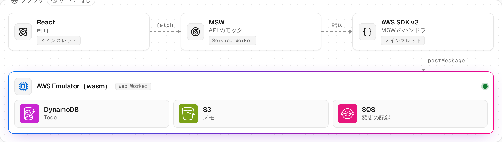

# aws-emulator-wasm

[AWS Emulator](https://github.com/aws/aws-emulator) をブラウザの中で動かす試みです。React アプリのモック API（MSW）の接続先にして、**GitHub Pages などの静的配信だけで完結するモックアプリ**を作れるようにすることが目標です。

> 状態：**Phase 1 完了**。ブラウザの Web Worker の中でエミュレーター（wasm）が動き、AWS SDK v3 から DynamoDB・S3・SQS を呼べます。MSW から使う Todo デモを公開しています（[Phase 1 レポート](./docs/phase1-report.md)）。
>
> - デモ：<https://daisuke-awaji.github.io/aws-emulator-wasm/>
> - SDK の往復テスト：<https://daisuke-awaji.github.io/aws-emulator-wasm/sdk.html>


## なぜ

リモートのコーディングエージェントが作ったアプリを人が確かめるとき、Docker や AWS アカウントを用意できるとは限りません。モックの裏側までブラウザの中にあれば、URL ひとつで共有できます。



この図はデモの画面の上部にあるものと同じです（`demo/src/Architecture.jsx`）。AWS のアイコンは [AWS Architecture Icons](https://aws.amazon.com/architecture/icons/)（2026-07-31 版）、ほかのアイコンは [Lucide](https://lucide.dev/) です。

## 内部のアーキテクチャ

ファイル単位で、1 回の SDK 呼び出しがどこを通るかを描いた図です。上の段は CI と配信、下の大きな枠が 1 つのタブの中です。


- 元の図：[`docs/architecture/architecture.drawio`](./docs/architecture/architecture.drawio)。PNG（`docs/img/architecture.drawio.png`）にも図のデータを埋め込んであるので、そのまま draw.io で開いて編集できます。SVG は [`docs/architecture/architecture.svg`](./docs/architecture/architecture.svg)。
- 図は `scripts/architecture.py` が座標から作ります。矢印はすべて縦か横の直線で、箱やラベルの上を通らないことをスクリプトが確かめます。書き直したら `python3 scripts/architecture.py && node scripts/render-architecture.mjs` で PNG と SVG を作り直します（描画に viewer.diagrams.net を使います）。
- アイコン：AWS のサービスは AWS Architecture Icons、ほかは [Simple Icons](https://simpleicons.org/)（CC0、`docs/architecture/icons/`）。

### SDK の呼び出し回数

デモの「SDK の呼び出し」欄は、操作ごとにエミュレーターが受けた呼び出しを並べます。画面は変更の API を呼んだあと、一覧と変更の記録を読み直すので、Todo を 1 件追加すると 6 回になります。

| 呼び出し | API | 目的 |
|---|---|---|
| DynamoDB PutItem | `POST /api/todos` | Todo を保存する |
| SQS SendMessage | `POST /api/todos` | 「追加」の記録を送る |
| DynamoDB Scan | `GET /api/todos` | 一覧を読み直す |
| SQS ReceiveMessage | `GET /api/activity` | 記録を受け取る（1 件） |
| SQS DeleteMessageBatch | `GET /api/activity` | 受け取った記録を消す |
| SQS ReceiveMessage | `GET /api/activity` | キューが空であることを確かめる |

起動時の準備（テーブル・バケット・キューの作成、初期データ 3 件、最初の読み込み）は 13 回です。累計の欄はこの 13 回を含みます。

## 使い方（ブラウザ）

```js
import { DynamoDBClient } from '@aws-sdk/client-dynamodb';
import { S3Client } from '@aws-sdk/client-s3';
import { createEmulator } from 'aws-emulator-wasm/browser';

const emulator = createEmulator({ wasmUrl: '/aws-emulator.wasm' });
const ddb = new DynamoDBClient(emulator.clientConfig());
const s3 = new S3Client(emulator.clientConfig({ forcePathStyle: true }));
```

- 状態はメモリの中だけにあり、ページを閉じると消えます。
- `createEmulator({ onCall })` を渡すと、エミュレーターが応答するたびに `{ seq, method, url, headers, status, ms }` で呼ばれます。デモはこれで「SDK の呼び出し」欄を作っています（`demo/src/calls.js`）。
- 時計は「仮想時計」が既定です。エミュレーターが待つ場面（作成直後の DynamoDB テーブルなど）では待たずに時計を進めます。詳しくは [Phase 1 レポート](./docs/phase1-report.md#2-設計で決めたこと)を参照してください。
- 載っているサービス：DynamoDB、S3、SQS と、それらが依存するサービス（計 13）。

## ドキュメント

- [PLAN.md](./PLAN.md)：計画書（構成、上流の調査結果、設計判断、段階計画、リスク）
- [docs/phase0-report.md](./docs/phase0-report.md)：Phase 0（wasm 向けビルド検証）の結果
- [docs/phase05-report.md](./docs/phase05-report.md)：Phase 0.5（wasm のビルドと Node での往復）の結果
- [docs/phase1-report.md](./docs/phase1-report.md)：Phase 1（ブラウザ、Todo デモ、Pages 公開）の結果
- [PROGRESS.md](./PROGRESS.md)：進捗の記録

## 上流

- リポジトリ：https://github.com/aws/aws-emulator
- 調査した commit：`813af480bf7f16d5418b64e4f5644a74a7da11c5`（2026-11-14）
- このリポジトリは上流のコードを含みません。取得スクリプトで固定 commit を取り寄せ、パッチを当てて使います。

## 構成

| 場所 | 役割 |
|---|---|
| `scripts/fetch-upstream.sh [dest] [起点クレート...]` | 上流を sparse checkout し、閉包に絞り、wasm パッチを当てる（`SKIP_WASM_PATCH=1` で当てない） |
| `scripts/closure.py` | 起点クレートからの path 依存の閉包を出す |
| `scripts/trim_workspace.py` | workspace の members を閉包に絞り、dev-dependencies を外す |
| `scripts/patch_wasm.py` | wasm32 用のパッチ集（P1〜P4）。`patches/files/` を使う |
| `scripts/architecture.py`・`scripts/render-architecture.mjs` | 内部のアーキテクチャ図（draw.io）を作り、PNG と SVG に描く |
| `crates/wasm-host/` | wasm の入口（router と C ABI） |
| `js/`（npm workspace `aws-emulator-wasm`） | WASI シム、Node とブラウザのローダー、SDK v3 の request handler、テスト |
| `demo/` | Vite + React + MSW の Todo デモ、SDK テストページ、Playwright のテスト |
| `.github/workflows/wasm.yml` | CI：wasm のビルドとサイズ計測 → Node テスト → ブラウザテスト → Pages へのデプロイ |

手順は [Phase 1 レポートの「再現」](./docs/phase1-report.md#5-再現)と [Phase 0.5 レポートの「再現」](./docs/phase05-report.md#5-再現)（wasm のビルド）を参照してください。
