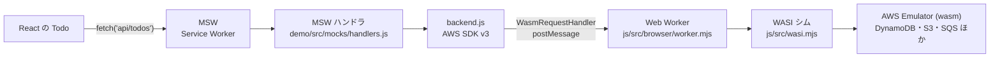
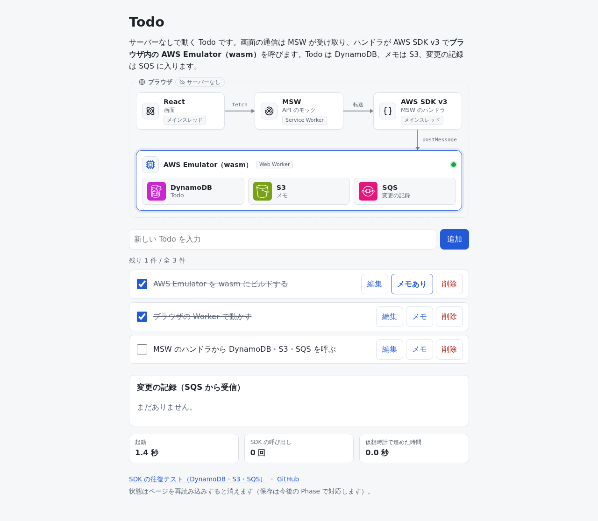
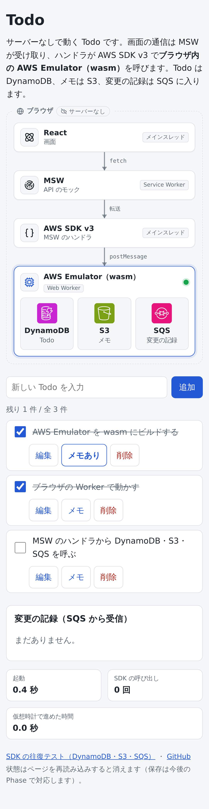

# Phase 1 レポート：ブラウザで動かす

- 実施日：2026-11-16
- 上流：`aws/aws-emulator` commit `813af480bf7f16d5418b64e4f5644a74a7da11c5`（Phase 0.5 と同じ。Rust 側の変更なし）
- 結論：**ブラウザの Web Worker の中で wasm のエミュレーターが動き、AWS SDK v3 から DynamoDB・S3・SQS を呼べた。MSW のハンドラから使う Todo デモを GitHub Pages に公開し、Playwright（Chromium、デスクトップとスマートフォン）の 12 テストが CI で通った。**
- 公開先：<https://daisuke-awaji.github.io/aws-emulator-wasm/>（Todo）、<https://daisuke-awaji.github.io/aws-emulator-wasm/sdk.html>（SDK の往復テスト）
- 根拠：GitHub Actions run [43812560700](https://github.com/daisuke-awaji/aws-emulator-wasm/actions/runs/43812560700)（commit `011f166`、build・browser・deploy の 3 ジョブとも success）。公開後の Pages も、手元の Chromium で開いて確認した（4 章）

## 1. 構成



| 場所 | 役割 |
|---|---|
| `js/src/wasi.mjs` | WASI preview1 の自前実装。依存なしで、ブラウザと Node の両方で動く |
| `js/src/core.mjs` | C ABI を呼ぶ部分（Node とブラウザで共通） |
| `js/src/browser/worker.mjs` | Worker の中で wasm を取得・コンパイルし、リクエストを 1 件ずつ処理する |
| `js/src/browser/index.mjs` | `createEmulator({ wasmUrl })`。`clientConfig()` を SDK のクライアントに渡すだけで使える |
| `js/src/handler.mjs` | SDK v3 の `requestHandler`（Node・ブラウザ共通）。本文の型の違いを吸収する |
| `js/test/scenarios.mjs` | DynamoDB・S3・SQS の往復シナリオ。Node のテストとブラウザのページが同じものを使う |
| `demo/` | Vite + React + MSW の Todo デモ、SDK テストページ、Playwright のテスト |

使い方は次のとおりです。

```js
import { DynamoDBClient } from '@aws-sdk/client-dynamodb';
import { createEmulator } from 'aws-emulator-wasm/browser';

const emulator = createEmulator({ wasmUrl: '/aws-emulator.wasm' });
const ddb = new DynamoDBClient(emulator.clientConfig());
```

## 2. 設計で決めたこと

### WASI は自前で実装した

ビルドした wasm が使う WASI の関数は 16 個（wasm-opt 後は 15 個）だけでした。ファイルは使わない（preopen なし）ので、既存のシムを入れるより、時計の扱いを決められる自前実装のほうが小さく済みます。実装していない関数は、リンクで失敗させずに `ENOSYS` を返します。

### 時計は「仮想時計」を既定にした

エミュレーターは、待つべきところで実際に `sleep` します（例：テーブル作成後 3 秒間は CREATING で、DescribeTable は ACTIVE になるまで待つ）。ブラウザの Worker で止まって待つには `Atomics.wait` が要りますが、それには SharedArrayBuffer、つまり COOP/COEP ヘッダーが要ります。GitHub Pages ではこのヘッダーを付けられません。

そこで、`poll_oneoff` での待ちは実際には待たず、**エミュレーターの時計を待つはずだった分だけ進めて**すぐ返すことにしました。DescribeTable は 3 秒待たずに ACTIVE を返します（ブラウザで約 5 ms）。

- 代わりに、エミュレーターの時刻は実際の時刻より先に進みます（Todo デモでは 1 回の DescribeTable で約 3 秒）。
- SQS の長いポーリング（WaitTimeSeconds）や可視性タイムアウトも、待ちが起きればその分だけ時計が進みます。
- `createEmulator({ clock: 'real' })` で、実際に待つ方式にも切り替えられます（Worker ではビジーウェイトになります）。

### 応答の本文の型

SDK は、ストリームで返す出力（S3 の GetObject）の本文に、環境ごとの型を求めます。ブラウザでは `ReadableStream` を渡しています（`Blob` だと、GetObject のチェックサム検証が `unsupported source type Blob in ChecksumStream` で失敗しました）。Node では `nodeResponseBody`（`Readable`）を渡します。

### Todo デモの API

画面は `fetch('api/...')` しか知りません。MSW がそれを受け取り、ハンドラが SDK でエミュレーターを呼びます。

| API | 中身 |
|---|---|
| `GET api/todos` | DynamoDB の Scan |
| `POST api/todos` | PutItem ＋ SQS に `created` を送る。タイトルが空なら 400 |
| `PATCH api/todos/:id` | UpdateItem（`attribute_exists(id)` の条件つき。なければ 404）＋ SQS |
| `DELETE api/todos/:id` | DeleteItem ＋ S3 のメモを削除 ＋ SQS |
| `GET / PUT api/todos/:id/note` | S3 の GetObject / PutObject（DynamoDB の `hasNote` も更新） |
| `GET api/activity` | SQS の ReceiveMessage と DeleteMessageBatch（変更の記録） |

起動のたびにテーブル・バケット・キューを作り、Todo を 3 件入れます。状態はページを閉じると消えます（保存は Phase 2）。

## 3. 結果

### テスト

| 種類 | 件数 | 内容 |
|---|---|---|
| Node（`npm test -w js`） | 17 | フレーム形式 5、WASI シム 6、SDK の往復 6（node:wasi と自前シムのそれぞれで DynamoDB・S3・SQS）。cargo build 版と wasm-opt 版の両方で実行 |
| Playwright（`npm run test:e2e -w demo`） | 12 | SDK テストページ 1 件と Todo 5 件を、デスクトップ Chrome と Pixel 7 で実行 |

Todo の E2E テストでは、操作のほかに次のことも確かめています。

- ページの外への通信が 0 件であること（wasm もアプリも同じサイトから配信される）。
- ページで例外が起きないこと。

### ブラウザでの時間（CI、Chromium）

SDK テストページ（`sdk.html`）の計測です（run 43812560700、wasm-opt 版、ローカルの `vite preview` から配信）。

| 操作 | デスクトップ | Pixel 7 |
|---|---|---|
| 起動（wasm の取得・コンパイル・インスタンス化） | 185 ms | 269 ms |
| CreateTable | 30.6 ms | 39.8 ms |
| DescribeTable（仮想時計で 3 秒の待ちを飛ばす） | 3.4 ms | 3.1 ms |
| PutItem（1 回目 / 2 回目） | 8.7 / 2.4 ms | 8.3 / 2.1 ms |
| GetItem | 3.4 ms | 3.5 ms |
| Query | 4.7 ms | 4.8 ms |
| ListTables | 2.1 ms | 2.2 ms |
| CreateBucket | 13.2 ms | 12.3 ms |
| PutObject | 13 ms | 10.3 ms |
| GetObject | 7.3 ms | 6.2 ms |
| ListObjectsV2 | 5.3 ms | 6.8 ms |
| DeleteObject | 2.6 ms | 2.4 ms |
| CreateQueue | 6.7 ms | 6.2 ms |
| GetQueueUrl・SendMessage・ReceiveMessage・DeleteMessage | 2.6〜5.1 ms | 同程度 |

Pixel 7 は Playwright のデバイス設定（画面サイズとタッチ）で、CPU は CI のランナーと同じです。実機の速度ではありません。

### 公開した Pages での確認

公開後の <https://daisuke-awaji.github.io/aws-emulator-wasm/> を、手元のヘッドレス Chromium で開きました（キャッシュなし）。

| 項目 | デスクトップ | Pixel 7 |
|---|---|---|
| ページを開いてから Todo 3 件が表示されるまで | 1.3 秒 | 1.0 秒 |
| Todo の追加 | 成功 | 成功 |
| SDK テストページ | pass | pass |
| 通信先のホスト | `daisuke-awaji.github.io` だけ | 同じ |
| ページの例外 | 0 件 | 0 件 |

公開サイトの画面（左：デスクトップ、右：Pixel 7。起動直後。2026-11-16 に構成図をアイコン付きに更新した後の画面）：

 

この時間は、手元の回線が速い場合の値です。wasm の転送量が約 8.8 MiB あるので、一般的な回線では数秒かかる見込みです。

### 配信サイズ

| ファイル | raw | 転送量（gzip） |
|---|---|---|
| `aws-emulator.wasm`（wasm-opt -Oz） | 26.6 MiB | **8.8 MiB**（Pages は `content-encoding: gzip`、`content-type: application/wasm` で配信。実測 9,266,201 バイト） |
| アプリの JS（React・MSW・SDK の DynamoDB / S3 / SQS / lib-dynamodb） | 617 KiB | 220 KiB |
| エミュレーターのクライアントと SDK の共通部分 | 291 KiB | 88 KiB |
| Worker | 5.5 KiB | 2.4 KiB |
| `mockServiceWorker.js` | 17 KiB | 5.3 KiB |

Pages の `cache-control` は `max-age=600` です。2 回目以降の読み込みも、10 分を過ぎると再検証になります（ETag での再検証に 304 が返り、転送量が 0 になることを確認しました）。

## 4. わかったこと・残った課題

- **ブラウザでも、Node と同じく 1 回の呼び出しは数 ms。** Worker との往復（postMessage）を足しても体感の遅れはありません。
- **初回の読み込みは wasm のダウンロードが大半を占める。** wasm-opt 後の転送量は 8.8 MiB（gzip）です。brotli なら 5.4 MB ですが、Pages は brotli で配信しません。Phase 2 で、サービスを絞る・`opt-level="z"` ・キャッシュなどを試します。
- **状態はページを閉じると消える。** Phase 2 でスナップショットか操作ログの再生を入れます。
- **1 タブに 1 つのエミュレーター。** 複数タブで状態を共有するには、SharedWorker か BroadcastChannel での調停が要ります（Phase 2）。
- **エミュレーターが panic するとインスタンスごと使えなくなる。** 今は `fetch` がエラーを返すだけです。作り直しと操作ログの再生は Phase 2 で扱います。
- **スレッドを使う操作は未確認。** Cognito の CreateUserPool、KMS の非対称鍵、DynamoDB の import・export は `spawn_blocking` を使うため、失敗する見込みです。

## 5. 再現

```bash
npm ci
# wasm は CI の artifact「aws-emulator-wasm」から取るか、Phase 0.5 の手順でビルドする
EMULATOR_WASM=path/to/aws-emulator.opt.wasm npm test -w js
EMULATOR_WASM=path/to/aws-emulator.opt.wasm npm run wasm -w demo   # demo/public/ にコピー
npm run dev -w demo                                                 # http://localhost:5173/
BASE_PATH=/aws-emulator-wasm/ npm run build -w demo
npx -w demo playwright install chromium
npm run test:e2e -w demo
```

## 6. 次の一手（Phase 2）

1. 状態の保存：スナップショット（エンジンに書き出しがあれば）か、状態を変えるリクエストの記録と再生。保存先は OPFS か IndexedDB。
2. 読み込みの短縮：サービスを絞ったビルドとサイズの比較、`opt-level="z"`、LTO。
3. panic からの復旧：Worker を作り直して操作ログを再生する。
4. 複数タブ：1 つのエミュレーターを共有するか、タブごとに分けるかを決める。
